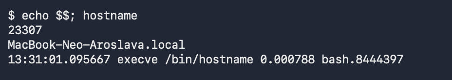
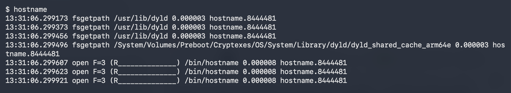
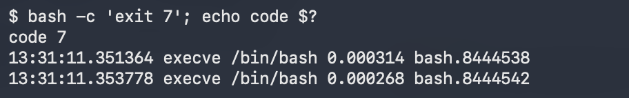
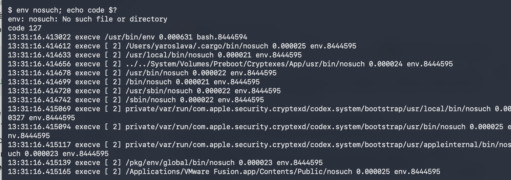
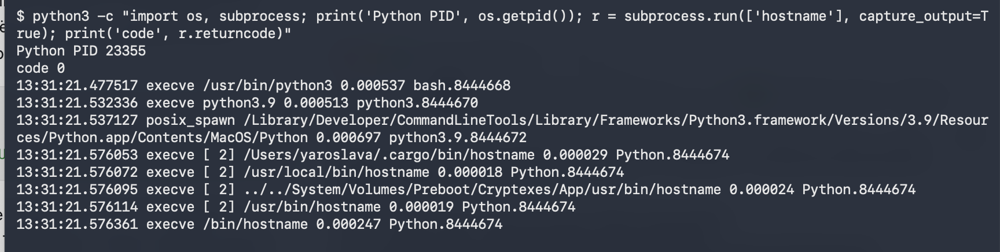

# ЛР 5. Рождение процесса

## Рождение

1. **Запуск hostname.** Родитель — `bash`, PID **23307**. В трассе виден `execve /bin/hostname`. PID нового процесса в записи отсутствует.
2. **Библиотеки.** Первое обращение — к загрузчику `/usr/lib/dyld`, затем виден общий кэш библиотек. `otool -L` показала одну прямую зависимость — `libSystem.B.dylib`.

## Завершение

3. **Код завершения.** Вторая оболочка выполнила `exit 7`. Родитель получил в `$?` код **7**.
4. **Поиск nosuch.** Проверено **12 папок**. Ошибка поиска — **2 (ENOENT)**, код завершения — **127**.

## Запуск из Python

5. **Запуск hostname.** PID Python — **23355**. Python запустил `hostname` через `subprocess.run`, забрал его вывод и получил код **0**. В трассе виден `execve /bin/hostname`, PID нового процесса отсутствует.

## Снимки экрана

